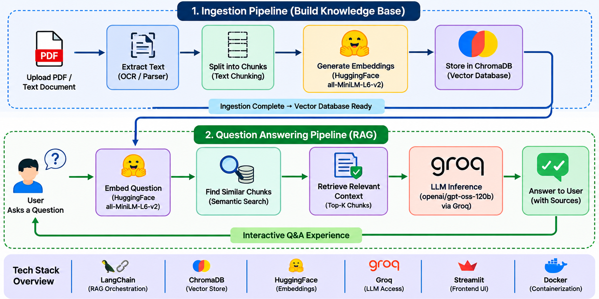

# DocuBot — AI Document Q&A Assistant

Upload a PDF and ask questions about its content in plain English. DocuBot uses Retrieval-Augmented Generation (RAG) to retrieve relevant document passages and generate context-based answers.

The embedding model runs locally for free. Answer generation uses the Groq API, subject to its current free-tier limits and availability.

## Architecture



**RAG workflow:**
1. Upload a document.
2. Extract text and split it into smaller chunks.
3. Convert chunks into embeddings using HuggingFace.
4. Store and retrieve relevant chunks using ChromaDB.
5. Send the retrieved context to the language model.
6. Display the generated answer in Streamlit.

## Tech Stack

| Tool | Purpose |
|---|---|
| Python | Core application |
| LangChain | RAG pipeline orchestration |
| ChromaDB | Vector storage and similarity search |
| HuggingFace `all-MiniLM-L6-v2` | Local text embeddings |
| Groq API `openai/gpt-oss-120b`| Language-model inference, Configured LLM |
| Streamlit | Interactive web interface |
| Docker | Containerization |

## Project Structure

```text
DocuBot-AI-Document-Q-A-Assistant/
├── data/
│   └── sample files
├── assets/
│   └── Rag.png
├── app.py
├── rag.py
├── ingest.py
├── config.py
├── eval_retrieval.py
├── requirements.txt
├── Dockerfile
├── .gitignore
└── README.md
```

## Setup and Run Locally

### 1. Clone the repository

```bash
git clone https://github.com/Harish19102003/DocuBot-AI-Document-Q-A-Assistant.git
cd DocuBot-AI-Document-Q-A-Assistant
```

### 2. Install dependencies

Create and activate a virtual environment, then install the requirements.

```bash
python.exe -m pip install --upgrade pip
python -m venv .venv && source .venv/bin/activate     # Windows: .venv\Scripts\activate
pip install -r requirements.txt
```

The HuggingFace embedding model downloads automatically on its first run and is cached locally.

### 3. Configure the API key

Create a `.env` file in the project root:

```dotenv
GROQ_API_KEY=paste_your_key_here
```

Get a key from [Groq Console](https://console.groq.com/keys). Keep your real API key private and never commit `.env` to Git.

### 4. Run the application

```bash
streamlit run app.py
```

Open [http://localhost:8501](http://localhost:8501) in your browser, upload a supported document, and ask questions about its content.

## Run with Docker

If the repository includes a configured Docker Compose file, create your local `.env` file and run:

```bash
docker compose up --build
```

Otherwise, build and run using the included Dockerfile:

```bash
docker build -t docubot .
docker run --env-file .env -p 8501:8501 docubot
```

Ensure the Docker image exposes the Streamlit port and that persistent document/vector-store storage is configured if needed.

## Tests and Evaluation

Run automated tests:

```bash
pytest
python eval_retrieval.py --docs data --qa data/qa_pairs.json --k 4
```

### Retrieval Evaluation Results

| Metric | Measured result |
|---|---:|
| Hit Rate @4 | 1.00 (100%) |
| Mean Reciprocal Rank (MRR) | 0.792 |

These results reflect the current eight-question evaluation set. Hit Rate measures how often a relevant expected phrase appears in the top four retrieved chunks. MRR measures the ranking of the first matching result. They do not independently establish the factual accuracy of generated answers.

## Example Use Cases

- Ask questions about textbook chapters.
- Explore research papers and technical documents.
- Identify required skills from a job description.
- Review a resume and ask questions about its contents.
- Retrieve relevant information from policy documents.

## Limitations

- Scanned PDFs without extractable text require OCR, which is not currently supported.
- Answer generation requires access to the configured Groq API.
- API usage is subject to provider limits and availability.
- The demo does not include user authentication.
- Retrieval and answer quality depend on document text extraction, chunking, and the relevance of retrieved passages.

